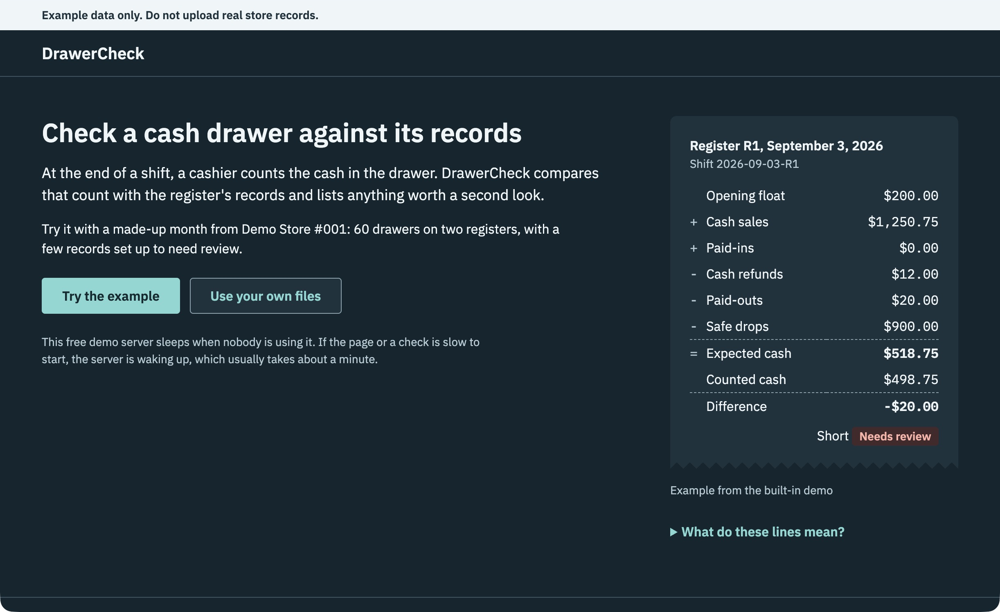
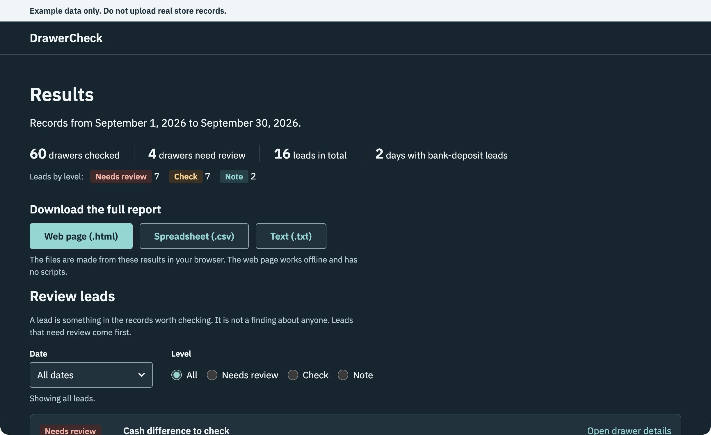
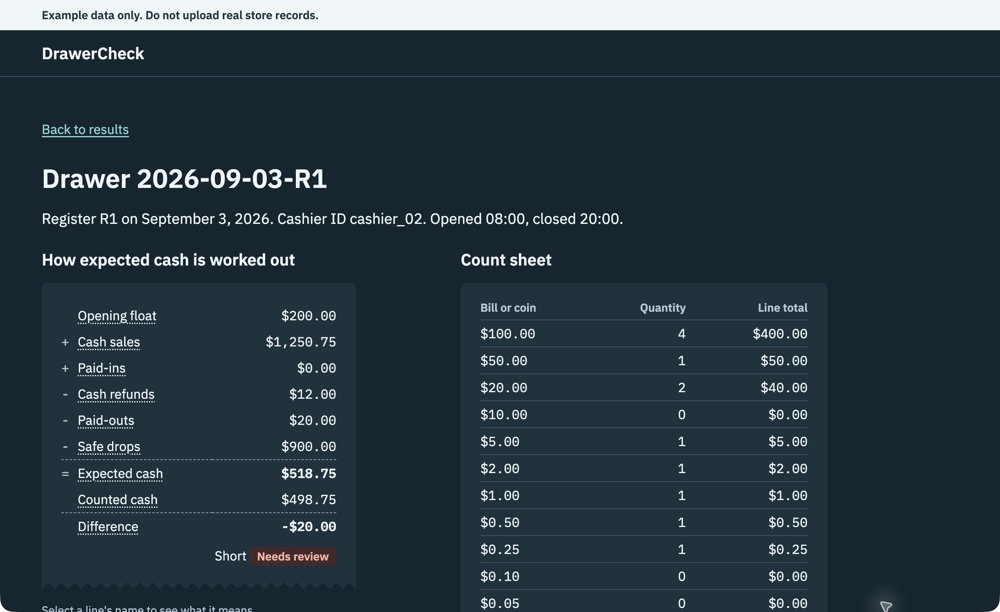
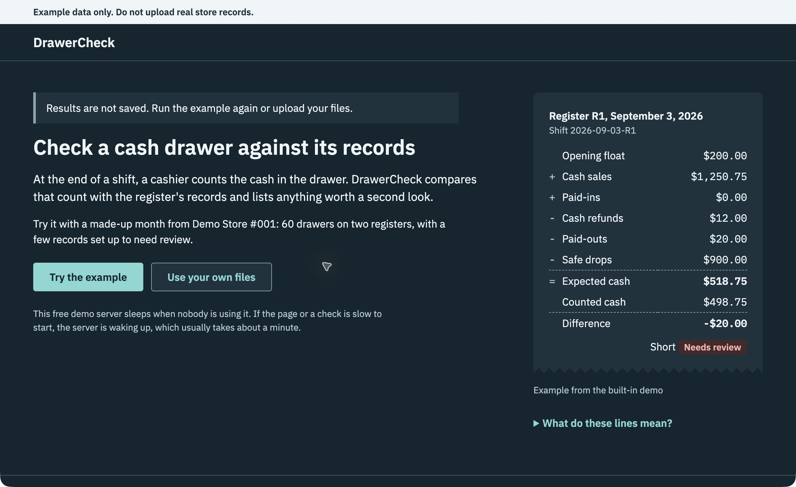
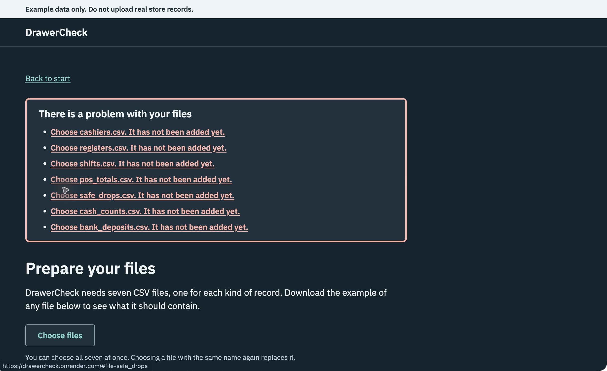

# M8 block 6 review, 2026-10-24

Reviewed commits `0ec9baf` and `4ea3d90`, plus the public site at
https://drawercheck.onrender.com. No application or deployment settings were
changed during this review. M8 block 7 has not started.

The tested normal flows worked. No fatal error or unrecoverable app state was
observed. One medium-priority hosting concern remains, plus two wording
suggestions. This is a bounded review, not a guarantee of uptime or capacity.

## Finding: the worker timeout does not bound each check

**Priority: medium.** `render.yaml:9` combines `--threads 4` with
`--timeout 30`. Gunicorn selects its threaded worker in this configuration.
Its timeout measures whether the worker is still communicating, rather than
the duration of an individual request. A slow request can therefore continue
beyond 30 seconds. The browser's Cancel button and 90-second limit stop the
browser waiting; they do not stop Python processing on the server.

The local reproduction used the real app factory, an extra temporary route
that slept for five seconds, one worker, and a shortened two-second timeout:

| Threads | Worker selected by Gunicorn | Observed result |
| --- | --- | --- |
| 4 | gthread | HTTP 200 after 5.00 seconds, despite the 2-second timeout |
| 1 | sync | HTTP 500 after 2.96 seconds and a `WORKER TIMEOUT` log |

Only the thread count changed between these runs. The temporary route was
never added to the repository or deployed. No deliberately slow requests or
load tests were sent to the public service.

This agrees with [Gunicorn's timeout documentation](https://gunicorn.org/reference/settings/#timeout).
The current test in `tests/test_web_page.py:381` checks command text and
`gunicorn --check-config`; it does not exercise timeout behavior. Passing it
does not establish a per-check processing limit.

**Impact:** normal demo checks are fast, but sufficiently slow or stuck checks
could occupy all four request threads and delay later visitors or health
checks. That exhaustion was not observed on the public service. Existing file,
row, evidence, and response-size limits still apply.

**Suggested follow-up:** choose how to bound server processing, add a test that
runs a deliberately slow request through the chosen server setup, and describe
the actual guarantee in the hosting notes. Account for concurrent visitors,
memory, and temporary-file cleanup when choosing the solution. Do not present
the existing worker timeout as a per-request deadline.

## Suggestions from the visible flow

1. On Start, consider changing `Use your own files` to `Upload demo CSVs`.
   The existing phrase can suggest real business records, while the banner
   correctly says to use example data only. This is optional wording polish,
   not a functional failure. See screenshot 1.
2. On Results, consider a short reminder beside downloads: results disappear
   when this page is refreshed or closed. Refresh recovery already works and
   explains what happened; a reminder before that event could prevent surprise.
   See screenshots 2 and 4. Keep the existing temporary-results design.

## Browser walkthrough

Native Google Chrome was driven through the computer-use tool. The in-app
browser was unavailable. Screenshots show the live site in dark mode at a
1,222-pixel window width, captured at 2x display scale. Only browser chrome was
cropped from the saved images; page content was not altered. These are viewport
captures, so long pages continue below the image. Each saved PNG was opened and
checked after cropping.

1. **Start: passed.** The purpose, example action, and fake-data notice are
   clear. Optional wording suggestion above.

   

2. **Run the example and download reports: passed.** Results showed 60 drawers,
   4 drawers needing review, 16 leads, and 2 days with deposit leads. All three
   download buttons produced completed downloads. The actual downloaded HTML,
   CSV, and text files matched reports produced by the local core, allowing
   only the different generation timestamps in HTML and text. CSV matched
   byte for byte.

   

3. **Open a drawer and return: passed.** Drawer `2026-09-03-R1` showed expected
   cash of $518.75, counted cash of $498.75, and a difference of -$20.00.
   Back to results returned to the review list.

   

4. **Refresh Results: passed.** The page returned to Start and explicitly said
   results were not saved, with instructions to rerun the example or upload.

   

5. **Submit without files: passed.** Prepare files listed all seven missing
   files and focused the error summary. The chooser could still be opened.
   The automated native chooser did not successfully submit the file
   selection, so a full browser upload is not claimed for this run. The chooser
   was cancelled and closed. Direct HTTP upload of the same seven fake files
   passed, as recorded below. The chooser limitation is not established as an
   application bug.

   

## Checks run

| Check | Result |
| --- | --- |
| `.venv/bin/pytest -q` | PASS: 685 tests in 18.38 seconds |
| `.venv/bin/ruff check .` | PASS |
| `.venv/bin/ruff format --check .` | PASS: 53 files already formatted |
| `git diff --check` | PASS before recording this review; repeated after documentation edits |
| Hosted [run 40075833849](https://github.com/GutsJr75/DrawerCheck/actions/runs/40075833849) | Observed through GitHub connector: Python 3.12, 3.13, and 3.14 jobs and their test steps all succeeded |
| Public homepage | HTTP 200 in approximately 0.27 seconds on an already running service |
| Public `POST /api/demo` | HTTP 200 in approximately 0.68 seconds |
| Public `POST /api/check` with seven repository demo CSVs | HTTP 200 in approximately 0.66 seconds; data matched the demo after normalizing generation timestamps |
| Seven public `/examples/<file>` downloads | All HTTP 200; every file matched the repository bytes |
| Public JavaScript, CSS, favicon, and four fonts | All HTTP 200; every asset matched the repository bytes |
| Public API reports | All three formats matched the local core reports using the same generation timestamp |
| Required security headers | Present on checked homepage, demo, examples, assets, 404, and 405 responses |
| Missing path and wrong request method | HTTP 404 and 405, with readable JSON errors |
| Gunicorn timeout reproduction | Confirmed threaded-worker behavior described above |

## Limits

No fresh Render cold start, sustained traffic, concurrent maximum-size public
uploads, memory usage, or Render dashboard settings/logs were inspected. The
local timeout reproduction establishes the behavior of the committed command;
it does not prove the dashboard has identical settings. No new full keyboard,
screen-reader, mobile, zoom, or accessibility-compliance audit was performed.
Screenshots and observed focus changes alone do not establish WCAG compliance.
Render's [free-service documentation](https://render.com/docs/free#spinning-down-on-idle)
still describes a roughly one-minute wake-up after 15 minutes without traffic.
